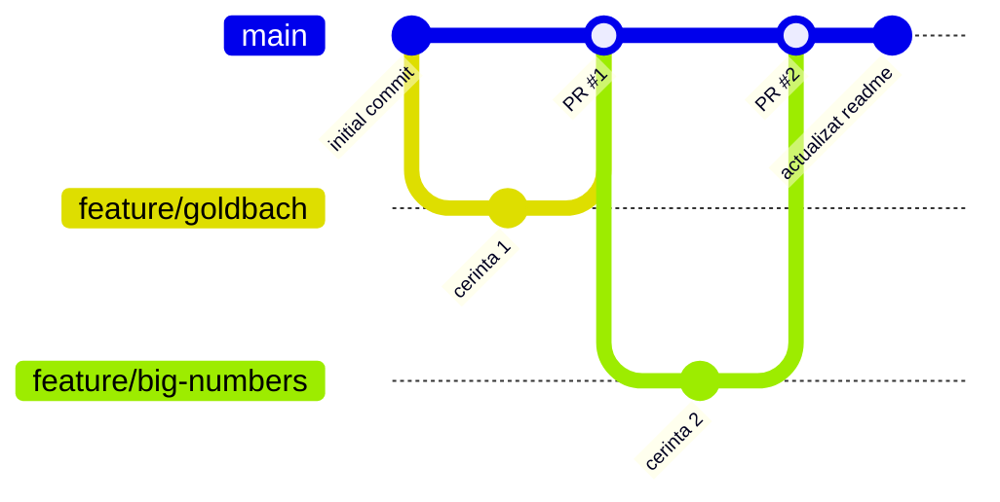

# Laborator 4 - Algoritmi Fundamentali

Rezolvarea cerintelor pentru Laboratorul 4.
Student: Garneata Dragos

## Cerinte implementate

### Cerinta 1: Conjectura lui Goldbach (`goldbach.py`)
- Citirea unui numar natural par $n > 2$ de la tastatura, cu validarea valorilor introduse.
- Verificarea numerelor prime printr-o functie proprie `este_prim(n)` (fara biblioteci externe).
- Afisarea tuturor perechilor de numere prime $(p, q)$ cu $p \le q$ pentru care $p + q = n$.
- Implementat pe branch-ul `feature/goldbach` si integrat prin Pull Request in `main`.

Rulare:
```bash
python3 goldbach.py
```

### Cerinta 2: Adunarea si inmultirea numerelor mari (`numere_mari.py`)
- Citirea a doua numere naturale (pana la 200 de cifre fiecare) din fisierul `numere.txt`.
- Validarea existentei fisierului si a corectitudinii datelor.
- Numerele sunt prelucrate ca siruri de caractere/cifre, fara conversia intregului numar la `int`.
- Adunarea cifra cu cifra de la dreapta la stanga cu transport.
- Inmultirea in coloana prin produse partiale si transport.
- Tratarea cazurilor cu 0, 1, transporturi finale si eliminarea zerourilor nesemnificative.
- Implementat pe branch-ul `feature/big-numbers` si integrat prin Pull Request in `main`.

Rulare:
```bash
python3 numere_mari.py
```

## Structura branch-uri si Pull Requests
- `main` - branch-ul principal
- `feature/goldbach` - Pull Request #1
- `feature/big-numbers` - Pull Request #2


